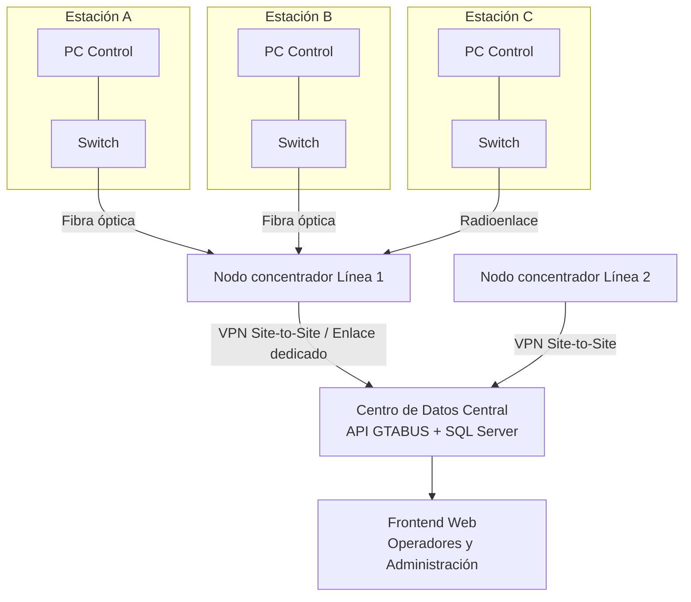

# GTABUS — Sistema de Control de Transmetro

Propuesta de sistema para el control de líneas, estaciones, buses y pilotos
del Transmetro de la ciudad de Guatemala y municipios aledaños.

```
├── gtabus-backend/      ← API REST (Node.js + Express + SQL Server)
├── gtabus-frontend/     ← Interfaz web (React + Vite)
└── README.md
```

---

## 1. Modelo de datos (resumen de entidades)

| Entidad | Resuelve la regla |
|---|---|
| `Municipalidad` | 11 |
| `Linea` | 13 (distancia total) |
| `Estacion` | 11 |
| `LineaEstacion` (N:M con orden) | 1 (ruta ordenada), 2 (estación en varias líneas), 12 (distancia entre estaciones consecutivas) |
| `Acceso` | 3 (1 estación → N accesos, 1 acceso → 1 estación) |
| `Guardia` | 10 (mínimo 1 guardia por acceso) |
| `Parqueo` | 6 |
| `Bus` | 4 (1 línea máx.), 7 (parqueo obligatorio), 14/15 (capacidad) |
| `HistorialParqueoBus` | 7 (bitácora de cambios de parqueo) |
| `Piloto` / `PilotoResidencia` / `PilotoComunicacion` / `PilotoHistorialEducativo` | 9 |
| `AsignacionPilotoBus` | operación (turnos) |
| `Operador` / `EquipoControl` | 16 |
| `Viaje` / `VisitaEstacion` / `AlertaEstacion` | 1 (visitas reales del recorrido), 14, 15 |

El script completo de creación está en
`gtabus-backend/database/schema.sql`, con comentarios que referencian cada
regla del enunciado. Dos triggers automatizan las reglas más delicadas:

- **`trg_ValidarBusesPorLinea`** → Regla 5 (máximo 2× el número de estaciones).
  El mínimo (≥ número de estaciones) se valida en la capa de negocio del
  backend antes de "activar" una línea, porque una línea nueva no tiene
  buses todavía y no se puede bloquear su creación por eso.
- **`trg_HistorialParqueoBus`** → Regla 7 (registra cada cambio de parqueo
  sin permitir que el bus quede sin uno, ya que la columna es `NOT NULL`).

---

## 2. Backend (`gtabus-backend/`)

- **Node.js + Express**, conexión a **SQL Server** vía el paquete `mssql`.
- Estructura por capas: `routes/ → controllers/ → config/db.js`.
- Endpoints clave:

| Método | Ruta | Descripción |
|---|---|---|
| GET | `/api/lineas` | Lista de líneas |
| GET | `/api/lineas/:id/estaciones` | Ruta ordenada (Regla 1) |
| GET | `/api/lineas/:id/accesos` | Todos los accesos de la línea (Regla 8) |
| GET | `/api/estaciones/:id/accesos` | Accesos + guardias (Regla 10) |
| GET | `/api/estaciones/:id/distancia/:id2` | Distancia entre 2 estaciones (Regla 12) |
| PUT | `/api/buses/:id/parqueo` | Cambio de parqueo (Regla 7) |
| POST | `/api/viajes/visitas` | Registra paso por estación; calcula alertas (Reglas 14 y 15) |

### Instalación
```bash
cd gtabus-backend
cp .env.example .env      # ajustar credenciales de SQL Server
npm install
npm run dev
```

---

## 3. Frontend (`gtabus-frontend/`)

React + Vite, consumiendo la API vía `axios` (`src/services/api.js`).
Páginas: Líneas, Detalle de línea (ruta, accesos, buses), Estaciones, Buses.

```bash
cd gtabus-frontend
npm install
npm run dev
```

---

## 4. Punto 17 — Conectividad entre las PC de las estaciones

Cada estación tendrá un **equipo de control (`EquipoControl`)** operado por
un **Operador** (Regla 16). La propuesta de red es la siguiente:

### 4.1 Topología

- **Red local por estación**: un switch administrable conecta la PC de
  control, cámaras y cualquier dispositivo IoT de la estación (torniquetes,
  sensores de ocupación). Topología en **estrella**, fácil de diagnosticar
  y ampliar.
- **Enlace estación ↔ centro de datos municipal**: como las estaciones están
  distribuidas geográficamente a lo largo de cada línea, no conviene una
  red local única; se usa una **WAN privada tipo estrella jerárquica**:
  - Estaciones **cercanas entre sí** (mismo tramo de línea) se agrupan bajo
    un **nodo concentrador** (armario de telecomunicaciones) conectado por
    **fibra óptica** (preferido) o radioenlace punto a punto donde no sea
    viable tender fibra.
  - Cada nodo concentrador se conecta al **centro de datos central de la
    municipalidad / ente rector del Transmetro** mediante un enlace
    dedicado o una **VPN site-to-site sobre el proveedor de
    telecomunicaciones**, de modo que todas las estaciones —incluso de
    distintos municipios— reporten a la misma base de datos (`GtaBusDB`).
- **Respaldo**: cada estación cuenta con una línea celular (4G/5G) como
  enlace de contingencia si falla la fibra, para no perder el registro de
  visitas ni las alertas de sobrecupo en tiempo real.



### 4.2 Justificación

- **Estrella por estación**: aísla fallas de un dispositivo sin afectar a
  los demás en la misma estación.
- **Concentradores por tramo**: reduce el número de enlaces largos y
  costosos hacia el centro de datos; solo el nodo concentrador necesita un
  enlace troncal.
- **VPN site-to-site**: garantiza que el tráfico entre estaciones (de
  distintas municipalidades) y la API central viaje cifrado sobre
  infraestructura de terceros (dado que las municipalidades no comparten
  necesariamente la misma red física).
- **4G/5G de respaldo**: da continuidad operativa (alertas de sobrecupo,
  Regla 14) aunque el enlace principal falle.

---

## 5. Notas de negocio implementadas en el backend

- **Regla 14**: si `pasajeros_abordo / capacidad_maxima >= 150%`, se crea un
  registro en `AlertaEstacion` automáticamente al registrar la visita.
- **Regla 15**: si la ocupación es `< 25%`, la respuesta del endpoint indica
  `minutos_espera_extra: 5` para que el operador/piloto lo aplique en la
  siguiente parada.
- **Regla 5**: el trigger de SQL Server impide asignar más buses de los
  permitidos a una línea; el mínimo se valida antes de poner la línea en
  operación (endpoint de "activación", a extender según necesidad).
